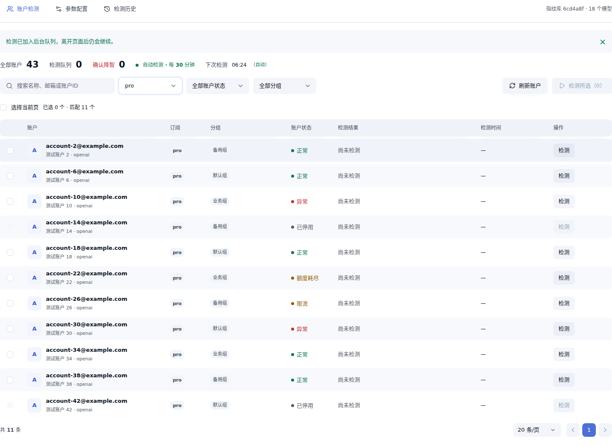
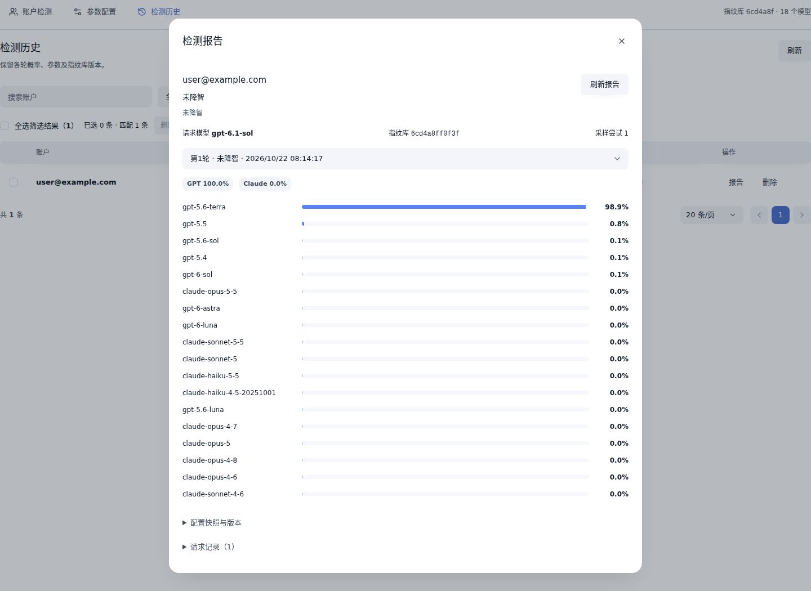

# CPR 账号降智检测

在 **Codex Proxy RS（CPR）** 管理页面中，批量检测账户的模型输出、查看指纹匹配结果，并按自定义规则执行复测、定时检查和账户处理。

项目基于 [ModelTrace](https://github.com/xqy2006/ModelTrace) 的数字指纹方法，比较账户实际回答与候选模型的匹配程度。检测、配置和报告均在插件页面完成，发布包内置 Python/NumPy 评分运行时。

**[下载插件](https://github.com/Victor-Tau/cpr-jzjc/releases/latest) · [使用指南](docs/usage.md) · [更新日志](CHANGELOG.md) · [开发与构建](docs/development.md) · [反馈问题](https://github.com/Victor-Tau/cpr-jzjc/issues)**

## 功能

| 功能 | 说明 |
| --- | --- |
| 单号与批量检测 | 支持 OpenAI 账户，按订阅、状态、分组、关键词和检测结果筛选；并行数可设为 1–16 |
| 自动复测 | 配置置信度阈值、降级模型名单和连续确认轮数，低置信度结果可自动复测 |
| 定时检查 | 按固定间隔或指定时区的每日时刻执行，支持动态筛选范围和固定账户列表 |
| 请求日志触发 | 配置 503 等错误码，匹配 CPR 请求日志后自动为对应账户排队检测 |
| 检测报告 | 查看每轮候选模型概率、家族概率、请求记录、配置快照与指纹库版本 |
| 确认后处理 | 可分别开启关闭账户调度、移入指定分组；操作失败可单独重试 |
| 指纹库更新 | 检查并应用上游指纹库，支持回退上一版本和恢复内置库 |
| 配置备份 | 导出、校验和导入 JSON 配置；更新现有实例时保留配置及历史 |

## 界面预览

以下截图使用模拟账户和模型响应，展示插件交互与报告形式。

查看检测报告

## 安装与升级

### 环境要求

| 项目 | 当前发布版本要求 |
| --- | --- |
| 插件版本 | **1.11.1** |
| CPR 宿主 | **>=3.36.0、<3.37.0** |
| 平台 | **Linux x86_64，glibc 2.36+** |
| 运行模式 | `trustedProcess` |
| 评分运行时 | 已包含私有 Python/NumPy，无需另装系统 Python 或部署 ModelTrace 服务 |

其他宿主版本请查看 [版本兼容表](CHANGELOG.md#宿主兼容性)，下载对应插件版本。

### 首次安装

1. 从 [Releases](https://github.com/Victor-Tau/cpr-jzjc/releases/latest) 下载 `personal.modeltrace-health-1.11.1-x86_64-unknown-linux-gnu.tar.gz`，可同时下载 `.sha256` 校验文件。
2. 在 CPR 中打开「插件管理 → 安装插件 → 上传包」，上传下载的安装包并启用。
3. 打开「账号降智检测 → 参数配置」，选择已有计量 Key，确认请求模型及判定规则，点击「保存全部参数」。
4. 回到「账户检测」，先选择一个账户执行检测，在报告中查看结果，再按需启用批量检测或定时检查。

下载的是 Release 附件中的插件安装包；GitHub 自动生成的 `Source code` 归档用于源码开发。

检测请求由宿主绑定到账户 ID，沿用该账户的代理，并计入所选 Key 的用量。Key 的账户分组和模型权限由宿主校验，插件页面只读取 Key ID 和名称。

首次检测会解出约 91 MB 的评分运行时，需要可写、可执行且空间充足的目录。容器临时目录受限时的配置见 [运行时排障](docs/usage.md#运行时无法启动)。

### 更新现有实例

在宿主插件管理中上传新版本包，更新并切换**现有插件实例**。同实例升级保留配置、计划、检测历史和指纹库；升级前也可在「参数配置 → 配置备份」导出配置。

[1.11.1](https://github.com/Victor-Tau/cpr-jzjc/releases/tag/v1.11.1) 修复 GitHub Release 摘要缓存导致的安装校验问题。详细变更见 [CHANGELOG](CHANGELOG.md)。

## 如何理解结果

默认请求模型为 `gpt-6.1-sol`，降级模型名单为 `gpt-5.6-luna`，低置信度阈值为 20%，降智阈值为 90%，连续确认 1 轮。可根据实际模型目录与检测目标调整这些参数。

| 结果 | 含义 |
| --- | --- |
| 确认降智 | 请求模型经别名映射后不在降级名单内，最高候选命中降级名单，并达到概率阈值与连续确认轮数 |
| 未降智 | 最高候选达到判定概率阈值，且未触发降智规则 |
| 低置信度 / 证据不足 | 当前回答不足以满足已配置的判定条件；是否复测取决于预算 |
| 检测失败 / 已中断 | 请求、凭据、参数或执行过程出现问题，原因可在报告中查看 |

ModelTrace 概率是当前候选库内、均匀先验下的相对概率。库外模型也会被归入现有候选；「降智」表示命中用户配置的规则，不能据此认证实际模型身份或测量智商。

定时检测、自动关闭调度、自动移组和后台检查指纹库更新均默认关闭。开启移组后，目标分组会替换账户原有的全部分组。完整默认值、复测规则和处理行为见 [使用指南](docs/usage.md)。

## 文档与反馈

| 文档 | 内容 |
| --- | --- |
| [使用指南](docs/usage.md) | 参数、复测与超时、自动计划、账户处理、配置备份、指纹库更新及排障 |
| [更新日志](CHANGELOG.md) | 各版本变化、发布日期与宿主兼容范围 |
| [开发与构建](docs/development.md) | 源码结构、开发环境、单核构建、测试与管理接口 |
| [验证记录](docs/verification.md) | 当前发行包的构建和回归结果、验证范围与复现命令 |

欢迎通过 [Issues](https://github.com/Victor-Tau/cpr-jzjc/issues) 反馈问题或提出建议，也欢迎提交 Pull Request。问题报告请附上插件版本、CPR 版本、部署环境、复现步骤与预期/实际结果；检测相关问题可附脱敏后的错误信息、请求耗时与指纹库版本。请移除密钥、账户令牌、代理认证信息和个人数据。

## 开源许可与致谢

本项目采用 [MIT License](LICENSE)。感谢 [ModelTrace](https://github.com/xqy2006/ModelTrace) 提供数字指纹方法与候选库，以及 [Codex Proxy RS](https://github.com/zyycn/codex-proxy-rs) 和 [@codex-proxy/ui](https://github.com/zyycn/codex-proxy-ui) 提供插件 SDK 与界面组件。

第三方组件遵循各自许可证，原始声明见 [NOTICE](legal/NOTICE.md)、[第三方许可证汇总](legal/THIRD_PARTY.txt) 和 [ModelTrace 许可证](vendor/modeltrace/LICENSE)。
